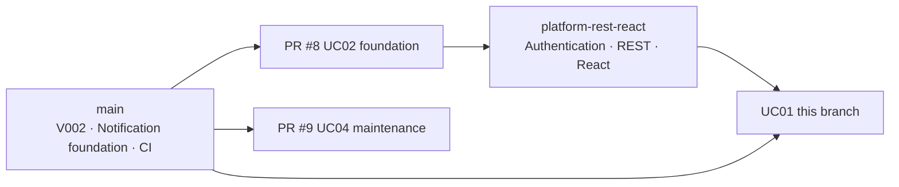

# Sprint Status and Risks

Member 1 updates after weekly meetings. Preserve snapshots, newest first, as Sprint evidence.

---

## Current Local Progress 2026-10-13

Verified baseline: GitHub main `940bf42`, local-demo delivery `d42e0a6` in [Draft PR #11](https://github.com/cpg25ncu/shared-equipment-reservation-and-maintenance-system/pull/11). This snapshot supersedes earlier progress claims; historical snapshots below remain unchanged.

The complete React/Spring Boot/PostgreSQL 18 local demo runs on loopback. The real backend and frontend-proxied health checks returned `UP` during the repository review. Local-demo files matched the delivered Git blobs. All nine PR #11 checks passed, including the eight required GitHub Actions checks; PR #11 remains draft and unmerged. Agent verification does not establish member acceptance or team Done.

| Work | Implementation/evidence | Remaining acceptance |
| --- | --- | --- |
| UC01 / Liu Tongyao takeover; original owner Shi Wenqi | Main: search, availability, reservation/cancellation, overlap protection; real normal-flow API checks | Complete exception/browser/member acceptance in Issue #9 |
| UC02 / Zhang Hanming | Main: secured API, approval pages, real database adapter; separate-approver API flow passed | Complete role/browser/member acceptance in Issue #8 |
| UC03 / Zhou Fanhao | Main: checkout/return, damage-to-maintenance, V004; 20 real PostgreSQL integration cases passed | Database/data/upgrade review in Issue #6 and cross-module member acceptance |
| UC04 / Liu Tongyao | Main: API/pages, assignment, diagnosis, repair, history/report reads; real normal-flow repair passed | Full fault/loan/technician/retirement exceptions in Issue #9; dedicated PostgreSQL profile is separate from regular CI |
| UC05 / Wang Yuanmeng | Main: inbox, request deduplication/retry, delivery and PostgreSQL reminder guard | Issue #7: overdue scanner/producer and full reminder/read/unread/return suppression acceptance; existing delivery worker only processes queued requests |
| Shared runtime / Liu Tongyao | Issue #5 local checks satisfied: native startup/shutdown, six explicit accounts, real APIs, idempotent data, restart | PR/member integration; no cloud acceptance implied |

Existing local evidence: database 27, app regression 536, UC03 integration 20; zero failures/errors/skips. Frontend 79 components and 12 mocked browser cases passed. Real API smoke passed 28 checks, data guards 3 and real browser 6. Local service/domain coverage was 97.04% (1115 covered/34 missed); an automatic ≥ 70% CI gate is still pending. See [local verification](../evidence/local-demo/verification.md) and [testing](../testing.md). The six real-browser checks exercise borrower login/navigation/history and viewport/error checks, not every role's complete workflow. Notification smoke asserts a populated inbox, not completion of overdue generation.

Current execution assignments: Liu Tongyao (`cpg25ncu`) #5/#9/#10; Zhou Fanhao (`zfh-usedname`) #6; Wang Yuanmeng (`ezmoneysniper0701`) #7; Zhang Hanming (`Hanming1008`) #8. Original team membership/contribution attribution remains intact; see [D-004](../collaboration/decisions.md#d-004-local-first-integration-and-wenqi-task-execution).

User-confirmed order: finish local repository housekeeping, complete basic local functionality and member acceptance, implement the user's later changes when specified, then cloud publication. Issue #10 is deferred; later feature scope is not yet defined. See [D-005](../collaboration/decisions.md#d-005-local-closeout-and-cloud-last).

Local housekeeping is on `codex/local-repository-closeout` based on `d42e0a6`: original 11 changes and UC04 history preserved, local main updated to `940bf42`, backup exclusions and current documents reconciled. Independent acceptance/release worktrees, archives and running demo data are retained. [Closeout handover](../local-repository-closeout.md) records recovery and boundaries.

GitHub main's last deployment failed with `missing server host`, and root Docker/Compose still packages the static welcome page. PR #3 remains open/conflicted; its older Wenqi handover text needs reconciliation with D-004/D-005. This local closeout prepares that content without changing remote PRs or production. No meetings, hours or human sign-offs are inferred.

## Local Delivery Update 2026-10-07

Database default configuration finalized: normal/local startup uses PostgreSQL 18, production migrations are in app's Flyway directory, approval is enabled; MySQL/H2 removed from production. Clean builds/default-runtime integration passed, pending team review and web/app/db deployment.

Zhou Fanhao implemented UC03 backend/React pages, State delegation, shared PostgreSQL profile, V004 decision/version alignment, ApprovalDecisionPort, and test scripts. See [Verification](../zhoufanhao-validation.md). Shared migrations and real Identity schema mapping address local gaps in snapshot risks 1–3.

The remote repository was suspended; this work changed only the backup and saved local Git. Review, hosted CI, security, web/app/db test deployment, Smoke Test, and Sprint Review remain team work. UC03 stays locally implemented, pending Review/Testing, not full Done. See [Member checklist](../zhoufanhao-handoffs.md). Long-term duties follow the provided plan; historical snapshots are retained.

## Snapshot: 2026-10-05 (Sprint 2 in Progress)

### 1. Use-case Progress

| Use case | Owner | Backend | Frontend | Test bench | Location |
| --- | --- | --- | --- | --- | --- |
| UC01 Search/reservation | Member 1 | ✅ | ✅ | ✅ Backend 69 + frontend 15 + E2E | UC01 branch (this PR) |
| UC02 Approval | Member 2 | 🔶 Domain/service, no REST | ⬜ | 🔶 Unit tests | [Draft PR #8](https://github.com/YukiOvOb/AGFP/pull/8) |
| UC03 Checkout/return | Member 3 | ⬜ (schema/constraints on main) | ⬜ | 🔶 Database tests (PR #10) | main `database/` |
| UC04 Maintenance | Member 4 | 🔶 Domain/service/JDBC/report reads | ⬜ | 🔶 PostgreSQL integration | [Draft PR #9](https://github.com/YukiOvOb/AGFP/pull/9) |
| UC05 Overdue/notifications | Member 5 | 🔶 Notifications main; REST branch | 🔶 Inbox branch | 🔶 | main + `feature/wang-yuanmeng-platform-rest-react` |
| Platform: authentication/templates/React | Member 2 / 5 | 🔶 | 🔶 | 🔶 | `feature/wang-yuanmeng-platform-rest-react` (no PR) |

### 2. Branch Dependencies

Suggested merge order: **PR #8 → platform-rest-react → UC01**. The platform branch's older main causes two small conflicts in `README.md` / `.gitignore`, already resolved in UC01 as a reference; UC01 passes all tests against latest main. PR #9 business files do not overlap, but both change `app/pom.xml` (same PostgreSQL driver version); retain one declaration manually.

### 3. Integration Risks (Team Decisions Required)

| # | Problem | Impact | Suggestion | Owner |
| --- | --- | --- | --- | --- |
| 1 | `app/` uses H2/MySQL; PostgreSQL migrations in separate `database/` | UC01–UC04 connect to real DB only in tests; deployed APIs unusable | Move V001/V002 into app Flyway, use PostgreSQL 18, remove `db/mysql` (technology stack §7) | Member 3 |
| 2 | Login queries `public.app_user` / `notification_principal`; V002 uses `serms` without column | Real login fails | Unify `serms`; recipients use `user_id` | Member 3 + Member 5 |
| 3 | V002 APPROVE/REJECT and integer versions differ from APPROVED/REJECTED and bigint contract | UC02 decision inserts fail CHECK | Add V003 (merged V002 cannot be edited) | Member 3 + Member 2 |
| 4 | Root Docker/Compose only deploy welcome page | Site lacks system | `web` + `app` + `db` (technology stack §7) | Member 5 |
| 5 | Shared Testcontainers base missing | UC01 `testsupport/SermsPostgres` and UC04 `Uc04PostgresTestSupport` duplicate facilities | Consolidate from `SermsPostgres`; use Flyway after migrations into app | Member 4 |
| 6 | 30 minutes / 7 days / 90 days / 3 reservations are provisional | Demo/report need consistent values | Sprint 2 review, configuration only | Team |
| 7 | Equipment four/five, maintenance five/six states (UC02 §9) | Report/implementation mismatch | Use V002 and explain in report | Member 3 + Member 4 |

### 4. Next Steps (Remaining Sprint 2)

1. Member 2: add REST/approval pages to PR #8 using this branch's tested `ReservationApprovalService`.
2. Member 3: integrate migrations (risks 1–3), start UC03.
3. Member 5: open platform PR; deploy three containers (risk 4).
4. Member 4: mark PR #9 ready; consolidate test base (risk 5).
5. Member 1: open UC01 PR and request member review; run real-DB demo after risk 1 is resolved.

### 5. Retrospective

Add meeting notes afterward:

| What worked | Improvements | Actions (owner, deadline) |
| --- | --- | --- |
| | | |
