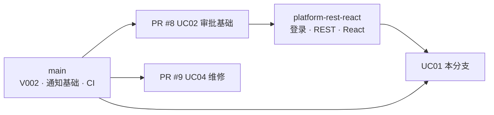

# Sprint 状态与风险

由 Member 1 在每周例会后更新。每次更新保留旧快照（新的写在最上面），作为 Sprint 证据。

---

## 快照：2026-10-05（Sprint 2 进行中）

### 1. 各用例进度

| 用例 | 负责 | 后端 | 前端 | 测试台 | 位置 |
| --- | --- | --- | --- | --- | --- |
| UC01 搜索和预约 | Member 1 | ✅ | ✅ | ✅ 后端 69 + 前端 15 + E2E | UC01 分支（本 PR） |
| UC02 审批 | Member 2 | 🔶 领域 + 服务，无 REST | ⬜ | 🔶 单元测试 | [Draft PR #8](https://github.com/YukiOvOb/AGFP/pull/8) |
| UC03 领用归还 | Member 3 | ⬜（表结构和约束已在 main） | ⬜ | 🔶 数据库测试（PR #10） | main `database/` |
| UC04 维修 | Member 4 | 🔶 领域、服务、JDBC、报表读模型 | ⬜ | 🔶 含 PostgreSQL 集成测试 | [Draft PR #9](https://github.com/YukiOvOb/AGFP/pull/9) |
| UC05 逾期和通知 | Member 5 | 🔶 通知已在 main；REST 在分支 | 🔶 收件箱在分支 | 🔶 | main + `feature/wang-yuanmeng-platform-rest-react` |
| 平台：登录 / 模板 / React 脚手架 | Member 2 / 5 | 🔶 | 🔶 | 🔶 | `feature/wang-yuanmeng-platform-rest-react`（未开 PR） |

### 2. 分支依赖

建议合并顺序：**PR #8 → platform-rest-react → UC01**。platform 分支基于较早的 main，合并最新 main 时 `README.md` 和 `.gitignore` 有两处小冲突，UC01 分支里已经解决，可直接参照；UC01 分支在最新 main 上通过全部测试。PR #9 与它们改动的业务文件不重叠，但 `app/pom.xml` 双方都改了（都加了同版本的 PostgreSQL 驱动），合并时手工保留一份。

### 3. 整合风险（需要全组决定）

| # | 问题 | 影响 | 建议 | 负责 |
| --- | --- | --- | --- | --- |
| 1 | `app/` 的数据源仍是 H2 / MySQL，PostgreSQL 迁移在独立的 `database/` 模块 | UC01–UC04 的接口只能在测试里连真实数据库，部署后无法真正使用 | 按 tech-stack §7 把 V001、V002 移入 `app` 的 Flyway 序列，`app` 改用 PostgreSQL 18，删除 `db/mysql` | Member 3 |
| 2 | 登录查询 `public.app_user` 和 `notification_principal` 列；V002 的表在 `serms` schema，没有该列 | 真实账号无法登录 | 统一用 `serms` schema；通知收件人直接用 `user_id` | Member 3 + Member 5 |
| 3 | V002 审批结果是 `APPROVE` / `REJECT`，合同要求 `APPROVED` / `REJECTED`；`version` 为 `integer`，合同要求 `bigint` | UC02 写审批记录会被 `CHECK` 约束拒绝 | 新增 V003 迁移修改（V002 已合并，不能再改） | Member 3 + Member 2 |
| 4 | `Dockerfile` / `compose.yaml` 仍只部署 welcome 静态页 | 线上看不到系统 | 改为 `web` + `app` + `db` 三个服务（tech-stack §7） | Member 5 |
| 5 | 公共 Testcontainers 基类尚未提交 | 各模块各写一套测试基础设施（UC01 `testsupport/SermsPostgres`，UC04 `Uc04PostgresTestSupport`） | 以 `SermsPostgres` 为起点合并成一个公共基类，迁移进 `app` 后改用 Flyway | Member 4 |
| 6 | 预约规则数值（30 分钟 / 7 天 / 90 天 / 3 个）是暂定值 | 演示和报告需要一致的数字 | Sprint 2 评审确认，只改配置 | 全组 |
| 7 | 设备状态四种 vs 五种、维修状态五种 vs 六种（UC02 合同 §9） | 报告与实现不一致 | 按 V002 为准，并在报告中说明 | Member 3 + Member 4 |

### 4. 下一步（Sprint 2 剩余）

1. Member 2：PR #8 补上 REST 与审批页，使用本分支的 `ReservationApprovalService`（已按合同实现并测试）。
2. Member 3：迁移整合（风险 1–3），开始 UC03。
3. Member 5：platform 分支开 PR；部署改为三容器（风险 4）。
4. Member 4：PR #9 转为正式 PR；整合公共测试基类（风险 5）。
5. Member 1：UC01 开 PR 并请一名组员评审；风险 1 完成后在真实数据库上跑一遍演示脚本。

### 5. 回顾

会议记录在例会后补充，格式：

| 做得好的 | 需要改进的 | 行动项（负责人、截止日期） |
| --- | --- | --- |
| | | |
