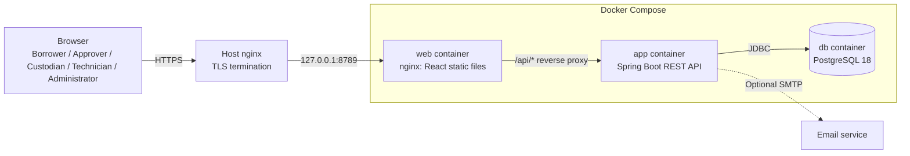
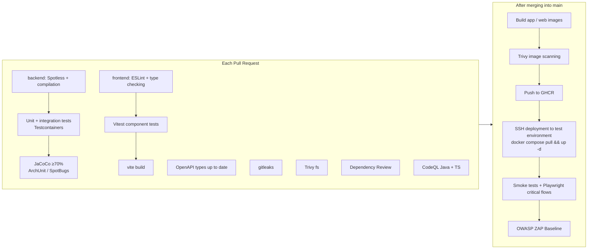

# SERMS Technology Stack

Current implementation snapshot: 2026-10-14, main `b3def12`, which includes the local demo (#11), the UC01/UC04 acceptance fixes (#14) and the Spring Boot 4 release preparation (#13). Default/local startup uses PostgreSQL 18, approval is enabled by default, and production Flyway V001-V004 is unified under `app/src/main/resources/db/migration`. MySQL production dependencies are removed; H2 is test-only. Liu Tongyao executes local integration and later release work under [D-004](collaboration/decisions.md#d-004-local-first-integration-and-wenqi-task-execution), preserving Shi Wenqi's team membership and original contribution. [D-005](collaboration/decisions.md#d-005-local-closeout-and-cloud-last) defers cloud deployment until basic local functionality and subsequent user-defined changes are accepted.

Team 07 · Shared Equipment Reservation and Maintenance System (SERMS)

This document defines the team's shared technology baseline. It is based on the Project Proposal (functional requirements in Chapter 5, business rules in Chapter 6, non-functional requirements in Chapter 7, and DevSecOps in Section 8.3) and the Definition of Done in the Project Plan. Section 3 maps each choice to its requirements; Section 4 explains differences from the Proposal and their rationale.

---

## 1. Complete Technology Stack

The system uses **separate frontend and backend applications**: a React single-page frontend, a Spring Boot backend exposing REST APIs only, and PostgreSQL 18 for storage.

The Status column describes verified implementation at main `b3def12`: ✅ implemented; 🔶 partial delivery or pending integration/acceptance, described in the row; ⬜ selected, not implemented. Items dropped by [D-009](collaboration/decisions.md#d-009-scope-freeze) say so in their row. Sections 2-6 include target design and required practices; naming a technology there does not mean it is installed or its gate is enforced. See [current progress](agile/sprint-status.md#integration-update-2026-10-14) for version-bound evidence and remaining acceptance.

### 1.1 Frontend (`frontend/`)

| Area | Technology | Version | Status |
| --- | --- | --- | --- |
| Language | TypeScript (`strict` mode) | 5.x | ✅ |
| Framework | React | 19 | ✅ |
| Build / development server | Vite | 7 | ✅ |
| Routing | React Router | 7 | ✅ |
| Server data fetching and caching | TanStack Query | 5 | ✅ |
| API client | openapi-typescript + openapi-fetch (types generated from the backend API specification) | — | ✅ Generated types and drift checks |
| Forms and validation | React Hook Form + Zod | — | ✅ |
| UI components / styling | shadcn/ui (Radix-based, with built-in accessibility) + Tailwind CSS | Tailwind 4 | ✅ Shared primitives/style |
| Tables | TanStack Table | 8 | ✅ |
| Charts | Recharts | 3 | ✅ Reports page, loaded only when opened (Issue #23) |
| Date and time | date-fns + date-fns-tz (displayed in Singapore time) | — | ✅ |
| Package manager / runtime | pnpm · Node.js LTS | Node 24 | ✅ |
| Code style | ESLint + Prettier | — | ✅ |
| Unit / component tests | Vitest + React Testing Library + MSW (API mocks) | — | ✅ |
| End-to-end tests | Playwright | — | 🔶 Existing mock browser suites; PR #11 adds limited real-browser checks; all-role acceptance open |

### 1.2 Backend (`app/`)

| Area | Technology | Version | Status |
| --- | --- | --- | --- |
| Language | Java | 17 | ✅ |
| Framework | Spring Boot (modular monolith) | 4.0.x | ✅ Upgraded from 3.5 by the user-authorized security migration ([D-006](collaboration/decisions.md#d-006-spring-boot-4-security-migration), PR #13) |
| Web API | Spring MVC JSON endpoints under `/api/v1` + Jakarta Bean Validation | Bundled with Boot | ✅ |
| API documentation | springdoc-openapi (OpenAPI 3) | 3.0.x | ✅ Test export/type generation; public production docs disabled |
| Error format | RFC 9457 Problem Details (Spring's built-in `ProblemDetail`) | Bundled with Boot | ✅ |
| Security | Spring Security: session cookie authentication, BCrypt password hashing, `@PreAuthorize` method authorization, and CSRF protection (cookie + request header) | Bundled with Boot | ✅ JSON identity, roles and CSRF |
| Data access | Spring Data JPA / Hibernate; handwritten SQL through JdbcTemplate for locking or complex queries | Bundled with Boot | ✅ |
| Scheduled tasks | Spring `@Scheduled` | Bundled with Boot | 🔶 Notification delivery worker; overdue scanner/producer still open |
| Operational endpoints | Spring Boot Actuator (only `health` and `info` exposed) | Bundled with Boot | ✅ |
| Build | Maven (Maven Wrapper `./mvnw`) | 3.9 | ✅ |
| Testing | JUnit Jupiter 6 · Mockito · AssertJ · Spring Boot Test | Bundled with Boot 4 | ✅ Transitional data/adapter benches retain JUnit 5 |
| Integration test database | Testcontainers (real PostgreSQL 18) | — | ✅ UC01/UC03; UC04 PostgreSQL acceptance runs in its own workflow (`maintenance-tests.yml`) |
| Layering checks | ArchUnit | — | ⬜ Dropped by D-009 |
| Coverage | JaCoCo (service + domain ≥ 70% as a merge gate) | 0.8.x | ✅ Reports generated; gate pending (Issue #24) |
| Code style / static analysis | Spotless (google-java-format) · SpotBugs + FindSecBugs | — | ⬜ Dropped by D-009; CodeQL covers static analysis (Issue #25) |

### 1.3 Database

| Area | Technology | Version | Status |
| --- | --- | --- | --- |
| Database | PostgreSQL (`postgres:18-alpine` in container-based checks; native local demo) | 18 | ✅ Default/local and CI; server acceptance deferred |
| Schema migrations | Flyway (the only schema creation mechanism) | Bundled with Boot | ✅ |
| Reservation overlap prevention | PostgreSQL exclusion constraints (`EXCLUDE USING gist` + `tstzrange`) | — | ✅ Shared migrations and concurrent reservation tests |
| Backups | Daily `pg_dump` backups retained for 7 days | — | ⬜ |

### 1.4 DevSecOps and Deployment

| Area | Technology | Status |
| --- | --- | --- |
| CI/CD | GitHub Actions | 🔶 Application/security checks pass; complete-system deployment pending |
| Secret scanning | gitleaks | ✅ |
| Vulnerability scanning | Trivy (filesystem + Docker images) | ✅ Filesystem scan on every PR; `app` and `web` image scans in the `release-images` check |
| Dependency checks | Dependency Review (PR stage) + Dependabot (weekly automated upgrades) | ✅ Dependency Review; 🔶 Dependabot configured, version updates paused until after the 2026-10-22 code freeze (majors ignored, minor/patch grouped) |
| Code security scanning | CodeQL (Java + TypeScript) | ⬜ Issue #25 |
| Post-deployment security scanning | OWASP ZAP Baseline | ⬜ Best effort in Issue #25 |
| Load testing | k6 (50 concurrent users) | ⬜ Best effort in Issue #25 |
| Containers | Docker (multi-stage builds, non-root execution) + Docker Compose: three containers, `web` + `app` + `db` | ✅ Packaging on `main`: non-root `app` and `web` images, PostgreSQL 18, production-profile Compose smoke in CI; not yet run on the server |
| Image registry | GitHub Container Registry (GHCR) | ⬜ |
| Server | Hong Kong server + nginx + Let's Encrypt, https://serms.midas.cyou | 🔶 Existing endpoint; server handover pending; deployment is gated and deferred to Issue #10 |

### 1.5 Optional Features (If Time Permits)

Both features below were dropped for this delivery by [D-009](collaboration/decisions.md#d-009-scope-freeze); the table records the original selection.

| Feature | Technology |
| --- | --- |
| Email notifications | Spring Mail; Mailpit receives test emails during development |
| QR codes | Generated with `qrcode` and scanned with `@zxing/browser` in the frontend |

### 1.6 Collaboration

| Area | Technology |
| --- | --- |
| Source control | Git + GitHub |
| Project management | GitHub Projects (board: To Do → In Progress → Review → Testing → Done) |
| Design diagrams | PlantUML / Mermaid (source files in `docs/diagrams/`), supplemented by draw.io |

---

## 2. Architecture

### 2.1 System Context and Deployment

The diagram below is the final deployment target. The current complete local demo uses loopback native React/Spring/PostgreSQL processes; root Docker/Compose still packages a static welcome page.



- **Same-origin deployment**: the frontend and `/api` share `https://serms.midas.cyou`. The web container's nginx forwards `/api/*` to the backend. This avoids CORS configuration and allows secure HttpOnly session cookies without storing JWTs in the browser.
- The database container exposes no public port; only the app container can access it.
- The Proposal explicitly excludes microservices and Kubernetes, so the backend runs as a single process.

### 2.2 Backend Code Structure (Modular Monolith)

The root package is `sg.edu.nus.serms`. Its top-level subpackages are organized by **business domain**, matching the Proposal's Section 7.5 requirement for users, equipment, reservations, borrowing, maintenance, and notifications:

```
sg.edu.nus.serms
├── identity       Users, roles, login, account activation/deactivation (5.1)
├── equipment      Equipment categories, records, search and availability (5.2, search in 5.3)
├── reservation    Submission/cancellation, conflict detection, borrowing rules (5.3)
├── approval       Approval/rejection and decision comments (5.4)
├── loan           Checkout, return, overdue detection (5.5)
├── maintenance    Fault reports, maintenance cases and history (5.6)
├── notification   In-app notifications, reminders, optional email (5.7)
├── report         Statistical reports (5.7)
├── audit          Audit records (5.7, business rule 9)
└── shared         Security configuration, global exception handling, time utilities
```

Each business module has four layers:

| Layer | Responsibilities | Prohibited |
| --- | --- | --- |
| `api` | REST controllers, request/response DTOs; obtain the current user from authentication | Business rules, direct repository access, returning JPA entities directly to the frontend |
| `service` | Transaction boundaries, use-case orchestration, authorization checks (`@PreAuthorize`) | HTTP-specific handling |
| `domain` | Business rules in entities, state machines, policy classes, etc. | Dependencies on Spring MVC |
| `repository` | JPA repositories or JdbcTemplate queries | Business decisions |

**ArchUnit tests** enforce these rules. For example, controllers must not access repositories directly; modules must not access another module's `repository`. Cross-module communication uses public `service` methods or events.

### 2.3 Frontend Code Structure

```
frontend/src
├── app/            Routes, global providers (QueryClient, authentication), page layout
├── api/            OpenAPI-generated types + shared request wrapper (CSRF headers, login redirect on 401)
├── components/     Shared components (shadcn/ui, tables, empty states, error messages)
├── features/       Business modules corresponding to the backend
│   ├── auth/  equipment/  reservation/  approval/  loan/
│   └── maintenance/  notification/  report/  admin/
└── lib/            Utilities (date formatting, permission checks)
```

- Each `features/<module>/` contains the module's pages, components, `useXxx` data hooks, and corresponding tests (`*.test.tsx`).
- **Role-based menus and buttons improve the user experience; all actual authorization checks run on the backend.**
- Page consistency (Proposal 7.4): reuse layout, form, table, and status badge components from `components/`; define English equipment and reservation status labels and colors centrally.

### 2.4 Frontend and Backend API Conventions

- All endpoints are under `/api/v1/...` and use JSON.
- The backend generates API documentation with springdoc-openapi (`/api/v1/openapi.json`, with Swagger UI available in development).
- The frontend generates TypeScript types from this specification using `openapi-typescript`. **Regenerate types when the API changes; mismatched fields fail compilation**, rather than being discovered at runtime. CI checks that generated types are current.
- Errors use consistent Problem Details (`type`, `title`, `status`, `detail`, plus field errors for validation failures), displayed through shared frontend handling.
- List endpoints share pagination parameters: `page`, `size`, and `sort`.

### 2.5 Communication Between Modules

- **Synchronous calls**: call another module's service when the result is needed immediately.
- **Domain events** (Observer pattern, implemented with Spring `ApplicationEventPublisher`): business actions publish events such as `ReservationSubmitted`, `ReservationDecided`, `EquipmentIssued`, `EquipmentReturned`, `LoanOverdue`, `MaintenanceAssigned`, and `MaintenanceCompleted`. The `notification` and `audit` modules subscribe to them.
  - Audit records and notification requests are written in the initiating business transaction; they roll back with the business operation.
  - Actual notification delivery runs through scheduled tasks after commit, with a bounded retry count.
- The frontend notification badge uses TanStack Query to poll the unread count (for example, every 30 seconds). WebSockets are not introduced; the Proposal excludes real-time chat.

---

## 3. Requirement Coverage: Technology Mappings

### 3.1 Functional Requirements

| Requirement (Proposal section) | Implementation |
| --- | --- |
| Login / logout (5.1) | The frontend submits `POST /api/v1/auth/login`; backend Spring Security creates a session with `HttpOnly`, `Secure`, and `SameSite=Lax` cookie attributes; `GET /api/v1/auth/me` returns the current user and roles |
| Five roles; multiple roles per user (3, 5.1) | Many-to-many `app_user` ↔ `role` tables mapped to Spring Security `ROLE_*` authorities |
| Role-based features (5.1) | The frontend displays menus and buttons based on `/auth/me` roles; **backend services enforce authorization with `@PreAuthorize`** |
| Administrator account and role management (5.1) | Frontend `features/admin` pages + backend `identity` endpoints; role changes create audit records |
| Equipment records; unique asset tags and serial numbers (5.2) | Database `UNIQUE` constraints; immediate frontend Zod validation and backend Bean Validation; duplicate identifiers return 409 with a field-level message |
| Equipment states; retain retired equipment history (5.2) | Enums with database `CHECK` constraints; centralized State pattern transitions. **State count pending confirmation**: Proposal 5.2 lists five (including Reserved), while the current model has four (`AVAILABLE`, `ON_LOAN`, `UNDER_MAINTENANCE`, `RETIRED`); see [Contract Section 9](contracts/auth-and-approval.md#9-items-pending-confirmation) |
| Search by name / category / location / time interval (5.3) | Backend JPA Specifications build dynamic queries; SQL interval overlap checks determine availability. Frontend search criteria are synchronized with URL parameters so refreshes and shared links preserve them |
| **No overlapping reservations** (5.3, rules 1 and 12) | PostgreSQL **exclusion constraint**: `EXCLUDE USING gist (equipment_id WITH =, tstzrange(start_at, end_at) WITH &&)`, applying only to pending approval / confirmed / fulfilled reservations. Availability checks and inserts share one transaction; the database rejects concurrent overlaps even if application checks are bypassed. The backend maps this error to 409, "This time slot is already reserved," and the frontend asks the user to choose another slot |
| Reservation validation: duration limits, eligibility, quotas, approval requirement (5.3, rules 10 and 11) | **Strategy pattern**: a `ReservationPolicy` interface with one strategy class per rule, composed by equipment category or borrower type |
| Cancel reservations (not after checkout) (5.3, rule 4) | Reservation state machine + conditional `UPDATE ... WHERE status IN (...)` |
| Approve / reject with comments (5.4) | `approval_decision` table, at most one immutable decision per reservation; self-approval prohibited; approval steps use the **Chain of Responsibility pattern**. See [docs/contracts/auth-and-approval.md](contracts/auth-and-approval.md) for endpoints and status codes |
| Pre-checkout validation; record checkout time and custodian (5.5) | A `loan` service transaction locks rows in a fixed order (equipment → reservation), validates, inserts the `loan`, and updates equipment state; the frontend custodian page supports lookup by reservation ID, borrower, or asset tag |
| Return, record condition, route damaged equipment to maintenance (5.5, rule 7) | Publish `EquipmentReturned`; when damage is recorded, create a maintenance case in the same transaction and mark equipment as under maintenance |
| Overdue detection and reminders (5.5) | `@Scheduled` scans; a **deduplication key** based on loan + reminder type + due time, enforced by a database unique constraint |
| View overdue equipment and overdue duration (5.5) | A backend query calculates `now() - due_at`; frontend TanStack Table sorts by overdue duration |
| Fault reports and maintenance workflow (5.6) | `maintenance_case` state machine (**State pattern**). **State count pending confirmation**: Proposal 5.6 lists six (including Closed), while the current model has five; see [Contract Section 9](contracts/auth-and-approval.md#9-items-pending-confirmation). Equipment with an open case is unavailable for reservation (rules 2 and 8) |
| Maintenance history (5.6) | Append-only cases and state-change records; the frontend displays a timeline on equipment details |
| In-app notifications (5.7) | `notification` table + inbox + navigation unread count; channels use a `NotificationChannel` interface (**Adapter / Factory Method pattern**), initially implementing in-app delivery only |
| Email notifications (optional) | Another `NotificationChannel` implementation using Spring Mail; Mailpit receives development emails |
| Reports (5.7) | Read-only SQL aggregation in backend `report` (`GET /api/v1/reports`, administrators only); frontend Recharts charts, each with a table view, + TanStack Table details. CSV export not built |
| Audit records (5.7, rule 9) | Append-only `audit_log` (database triggers reject `UPDATE` and `DELETE`); domain event listeners record actor, action, target, and time |
| QR codes (optional) | The frontend generates codes for asset tags; custodians can scan with a camera or enter identifiers manually |

### 3.2 Non-functional Requirements

| Requirement (Proposal 7) | Implementation |
| --- | --- |
| Secure password hashing | Spring Security `DelegatingPasswordEncoder`, defaulting to BCrypt with a seamless upgrade path to Argon2 |
| Server-side authorization | `@EnableMethodSecurity` + service `@PreAuthorize`; coarse URL-level checks as well; hiding frontend buttons is not authorization |
| Input validation | Frontend Zod (immediate feedback) + backend Bean Validation (authoritative validation) + database constraints |
| CSRF protection | Spring Security `CookieCsrfTokenRepository` issues `XSRF-TOKEN`; the frontend wrapper adds `X-XSRF-TOKEN` to mutation requests |
| XSS protection | React escapes output by default; ESLint prohibits `dangerouslySetInnerHTML`; nginx supplies CSP response headers |
| Keep secrets out of source code | Environment variables; `/opt/agfp/.env` on the server and GitHub Secrets in CI; no secrets in frontend build output; gitleaks scans the full Git history |
| Keep credentials out of logs | Backend request bodies are not logged; Actuator exposes only `health` and `info` |
| HTTPS | Host nginx + automatic Let's Encrypt renewal (already configured) |
| Response within 2 seconds; 50 concurrent users | Index frequent query fields, paginate lists, use HikariCP; nginx serves static files with long-lived caching; Sprint 3 k6 tests with 50 concurrent users provide evidence |
| Reports complete within 5 seconds | Indexed aggregation queries; materialized views if data volume grows |
| Related writes in one transaction; no partial data on failure | Service `@Transactional`; JPA `@Version` optimistic locking prevents lost updates (409 conflicts prompt a refresh); checkout / return use a fixed lock order to avoid deadlocks |
| Errors do not expose internals | Global backend exception handling returns Problem Details without stack traces; shared frontend error component |
| Backup and recovery | `scripts/backup.sh`: daily `pg_dump` with 7-day retention; `docs/runbook-backup.md` documents recovery, exercised at least once |
| Consistent UI; desktop and tablet support | shadcn/ui + responsive Tailwind layouts; shared layout, form, table, and status badge components |
| Shared coding standards | Backend Spotless and frontend ESLint + Prettier enforced in CI; violations block merging |
| Presentation / business / data layers | Separate frontend and backend; backend layers from Section 2.2 enforced by ArchUnit |
| Unit tests for business rules | JUnit Jupiter 6 + Mockito for strategies, state machines, and domain services |
| Integration tests for security, persistence, and workflows | Spring Boot Test + Testcontainers (PostgreSQL 18), focusing on concurrent reservations, checkout/return races, and authorization |
| service / domain coverage ≥ 70% | JaCoCo `check` counts only `**.service.**` and `**.domain.**`; coverage below 70% fails the build |
| Consistent time handling | Database `timestamptz`, Java `Instant`, ISO-8601 UTC API strings, frontend display in `Asia/Singapore` |

### 3.3 DevSecOps Pipeline (Proposal 8.3 + DoD Items 7 and 8)



| Stage required by the Proposal | Tool / task |
| --- | --- |
| Source code checkout | `actions/checkout` |
| Application compilation | Backend `./mvnw verify`; frontend `pnpm typecheck && pnpm build` |
| Unit and integration testing | Backend JUnit Jupiter 6, Mockito, Spring Boot Test, Testcontainers; frontend Vitest + React Testing Library + MSW |
| Test coverage generation | JaCoCo (backend) + Vitest coverage (frontend), uploaded as CI artifacts |
| Static code analysis | SpotBugs + FindSecBugs, CodeQL (Java + TypeScript), Spotless, ESLint, ArchUnit |
| Dependency vulnerability checking | Dependency Review (PR stage, Maven + npm) + Dependabot (weekly upgrade PRs) + Trivy fs |
| Application packaging | Executable Spring Boot JAR; frontend static files |
| Docker image creation | Two multi-stage images: `app` (`eclipse-temurin:17-jre`) and `web` (`nginx-unprivileged`), both running as non-root |
| Container vulnerability checking | Trivy image; HIGH / CRITICAL vulnerabilities fail the check |
| Deployment to a test environment | GitHub Actions runs `docker compose pull && up -d` over SSH; Flyway migrates the database on backend startup |
| Basic post-deployment verification | Smoke tests (`/api/v1/health` returns UP, homepage returns 200) + Playwright login and reservation flow + ZAP Baseline |

**Required checks** (configured in main branch protection): `backend`, `frontend`, `Secrets scan (gitleaks)`, `Vulnerability scan (Trivy)`, `Dependency review`, and `CodeQL`.

### 3.4 Environments

| Environment | Purpose | Database | Startup |
| --- | --- | --- | --- |
| Local development | Coding and debugging | PostgreSQL 18 from `compose.dev.yaml` | Backend `./mvnw spring-boot:run`; frontend `pnpm dev` (Vite proxies `/api` to the backend for the same-origin behavior used in production) |
| CI | Automated testing | Temporary PostgreSQL 18 from Testcontainers | GitHub Actions |
| Test / demo | Sprint Review, acceptance, demo | PostgreSQL 18 in Compose with a persistent data volume | Automatically deployed after merging into main |

Local development, CI, and the server must use the same PostgreSQL major version (18), with the image consistently set to `postgres:18-alpine`.

### 3.5 Design Pattern and Technology Mappings (Proposal 9.3)

| Pattern | Application | Implementation |
| --- | --- | --- |
| Strategy | Borrowing duration, quotas, eligibility, approval requirement | Multiple `ReservationPolicy` Spring beans composed by category |
| Chain of Responsibility | Approval steps | `ApprovalHandler` chain injected by Spring in `@Order` order |
| State | Equipment, reservation, and maintenance case transitions | Domain state classes backed by database `CHECK` constraints |
| Observer | Business events → notifications and audits | Spring domain events + synchronous transactional listeners |
| Adapter / Factory Method | Notification channels (in-app, email) | `NotificationChannel` interface + concrete implementations enabled by configuration |

---

## 4. Differences from the Proposal and Rationale

| Proposal | Current choice | Rationale |
| --- | --- | --- |
| Thymeleaf, HTML, CSS, Bootstrap, JavaScript (server-rendered pages) | **React 19 + TypeScript + Vite SPA**, shadcn/ui + Tailwind; backend exposes REST APIs only | Components support interactive reservation calendars, interval search, approval queues, and report charts, with component and end-to-end tests. OpenAPI-generated types catch API mismatches at compilation. Separate frontend/backend development reduces conflicts among five parallel contributors and reinforces the presentation / business / data separation required by Proposal 7.5 |
| MySQL | **PostgreSQL 18** | Range types and exclusion constraints enforce the no-overlap rule (rules 1 and 12) directly in the database, including under concurrency. MySQL lacks this feature and requires application locking. `timestamptz`, `CHECK` constraints, and partial indexes suit state and time data |
| H2 test database | **Testcontainers + real PostgreSQL 18** | H2 cannot reproduce exclusion constraints, row locks, or concurrency behavior; passing H2 tests does not establish production correctness |
| SpotBugs **or** PMD | SpotBugs + FindSecBugs, plus CodeQL | FindSecBugs targets security issues; CodeQL covers Java and TypeScript; Spotless / Prettier handle style |
| OWASP Dependency-Check **or** Dependabot | Dependabot + Dependency Review + Trivy | Covers Maven and npm dependencies using GitHub-native tools with no additional configuration, catching issues at the PR stage |
| Deployment platform undecided | Hong Kong server (domain and HTTPS configured) + GHCR images | Available without relying on student credits; images are built and scanned in CI before deployment |
| Jira or GitHub Projects | GitHub Projects | PRs, issues, and DoD evidence can be linked in one place |
| — | **Added** ArchUnit, Testcontainers, Playwright, MSW, k6, OWASP ZAP, Actuator, springdoc-openapi | Turns Section 7.5 layering requirements, Section 7.2 performance targets, and Section 8.3 post-deployment verification into automated checks with evidence |

---

## 5. Test Benches: Each Member Owns Their Tests

**CI can only run existing tests; it cannot establish the correctness of an untested feature.** Each member must therefore provide a complete test bench for their use cases and submit it with the feature code. Every PR can then verify itself in CI without waiting for manual testing, and regressions in other modules can be detected before merging.

### 5.1 Requirements for Every Test Bench

1. Put **backend tests** in `app/src/test/java/sg/edu/nus/serms/<module>/`; colocate **frontend tests** with components at `frontend/src/features/<module>/**/*.test.tsx`.
2. **All three backend test layers are required**:
   - **Unit tests**: domain rules, strategies, and state machines; no database, completing in milliseconds (JUnit Jupiter 6 + Mockito).
   - **Integration tests**: service + repository + real PostgreSQL 18 (Spring Boot Test + Testcontainers), covering transactions, constraints, and concurrency.
   - **API / authorization tests**: normal controller requests, validation failures (400 with field errors), unauthorized access (401 / 403), and missing CSRF headers (MockMvc + spring-security-test).
3. **At least two frontend test layers are required**:
   - **Component tests**: module pages and forms, including validation, loading, empty states, and API errors (Vitest + React Testing Library with MSW API mocks).
   - **End-to-end tests**: at least one Playwright script for the use case's main flow (for example, login → search → successful reservation).
4. **Cover the normal flow and all major exception flows**: follow the table below, with at least one test method for each exception flow.
5. **Run independently**: with Docker and Node installed, `./mvnw verify` (backend) and `pnpm test` (frontend) must complete without manually creating databases, setting environment variables, or running extra scripts. CI uses the same commands.
6. **Independent of other tests**: each test prepares its own data (random UUIDs or unique identifiers), does not depend on execution order, does not clear tables used by others, and does not assume it owns all table data.
7. **Test behavior, not implementation**: assert business outcomes, database state, HTTP responses, and user-visible content rather than private method calls.
8. **Submit tests in the same PR as the feature**. PRs introducing behavior without tests must not merge; backend service + domain coverage below 70% fails CI.

### 5.2 Each Member's Test Bench Scope

| Member | Use case | Minimum coverage |
| --- | --- | --- |
| Shi Wenqi | Search and reserve equipment | Filtered search; interval availability; successful reservation; conflicts (including two concurrent requests for one slot, with only one succeeding); no reservations for equipment under maintenance / retired; duration or quota rejection; borrower cancellation; cancellation prohibited after checkout. Frontend: search validation and conflict messages |
| Zhang Hanming | Review and approve reservations | Automatic confirmation when approval is unnecessary; approval; rejection with comments and slot release; no self-approval; non-approvers denied; immutable approval records. Frontend: pending list and required rejection comments |
| Zhou Fanhao | Equipment checkout and return | Normal checkout; invalid checkout (unapproved, outside the checkout window, equipment mismatch); normal and overdue returns; damaged returns automatically create maintenance cases; concurrent checkout of one item succeeds only once. Frontend: lookup by reservation ID / borrower / asset tag and recording return condition |
| Liu Tongyao | Fault reports and maintenance handling | Fault reports immediately block reservations; technician assignment; six-step maintenance transitions and rejection of invalid transitions; restored availability after repair; retirement if unrepairable; complete history retention. Frontend: case action buttons show only currently permitted operations |
| Wang Yuanmeng | Overdue detection and notifications | Due-soon and overdue reminders; successful delivery; retries after failure and terminal failure at the limit; deduplication; cancellation of unsent reminders after return; recipients see only their own notifications. Frontend: inbox, unread count, mark as read |

**Zhang Hanming** (test strategy owner) maintains shared test infrastructure: backend Testcontainers bases, test data builders, and ArchUnit rules; frontend shared MSW handlers, authenticated render utilities, and Playwright login fixtures. Other members reuse these rather than create separate equivalents.

### 5.3 How CI Uses the Test Benches

- Every PR automatically runs backend `./mvnw verify` and frontend `pnpm lint && pnpm typecheck && pnpm test && pnpm build`, covering all modules.
- Any failing test blocks merging. If a change breaks another module's tests, fix the regression before merging.
- Test and coverage reports are uploaded as CI artifacts and serve as the DoD's test evidence.
- Do not skip, delete, or comment out tests to make CI pass (`@Disabled` / `it.skip` requires a reason in the PR description and another member's agreement).

---

## 6. Team Conventions

1. **One backend application** (`app/`) and **one frontend application** (`frontend/`); do not create separate projects for individual features.
2. **One Flyway migration sequence**: `app/src/main/resources/db/migration/V{three-digit-number}__{description}.sql`. Never edit merged migrations; add a new migration for schema changes. If numbers conflict, the PR merged later must renumber its migration.
3. `spring.jpa.hibernate.ddl-auto=validate`: Hibernate validates the schema without creating or altering tables.
4. Use PostgreSQL **18** everywhere: `postgres:18-alpine` in local development, CI, and the server.
5. Store all timestamps in UTC, transmit ISO-8601 API strings, and convert to Singapore time only for frontend display.
6. Business operations requiring a check followed by a write (reservation, checkout, return) must run in a single service transaction backed by database constraints.
7. Backend API changes require regenerated frontend API types in the same commit.
8. New Maven or npm dependencies must pass Dependency Review and Trivy; document the source and license of external code in the PR description.

## 7. Aligning Existing Code

- **On main `b3def12`**: React pages and JSON identity/notification APIs replace the earlier page-only platform. Default/local app configuration uses PostgreSQL 18; MySQL production dependencies are removed and H2 is test-only. Flyway V001-V004, real approval persistence, UUID Identity mapping and the notification bridge are integrated. UC01-UC04 and their current test benches are present.
- **Local runtime (merged from #11)**: isolated native PostgreSQL 18, explicit demo accounts, startup/shutdown, real API/data/browser checks and restart preservation. Its hosted CI passed; member acceptance remains separate.
- **Retained transitional modules**: `database/` supplies data regression/history checks, and `integration/notifications/` supplies app-included PostgreSQL adapters plus pinned historical contract verification. Removing or renaming these modules requires its own integration task; this closeout does not remove them or rewrite merged migrations.
- **Remaining local work**: full Issues #6-#9 acceptance, overdue scanner/producer, complete role/browser flows, shared test consolidation, automatic coverage enforcement, and the Proposal scope listed on Issue #27 (user/role administration, equipment and category management, reports, audit viewer). Existing requirements in §5 continue to apply; local reports are not an enabled CI gate.
- **Final release work**: web/app/db packaging, the release-SHA gate and the deployment script are on `main` (from #13). Issue #10 still needs the server handover, the first-admin bootstrap (Issue #18), database storage/backups and actual deployed acceptance. Cloud execution is last under D-005.
