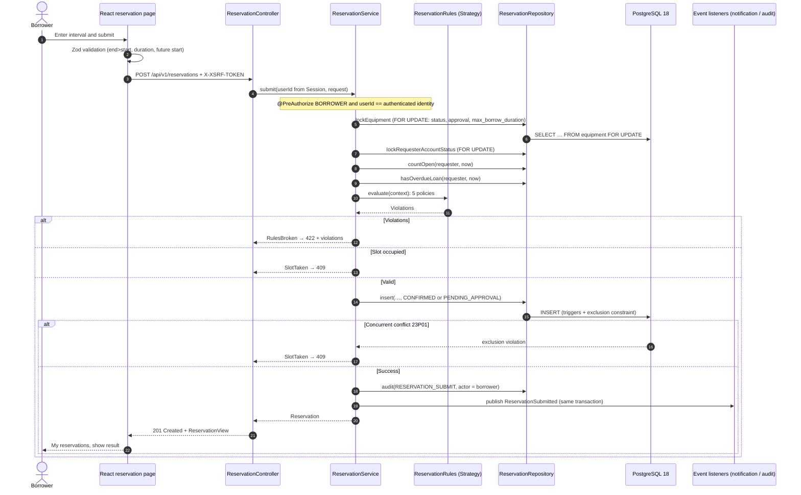
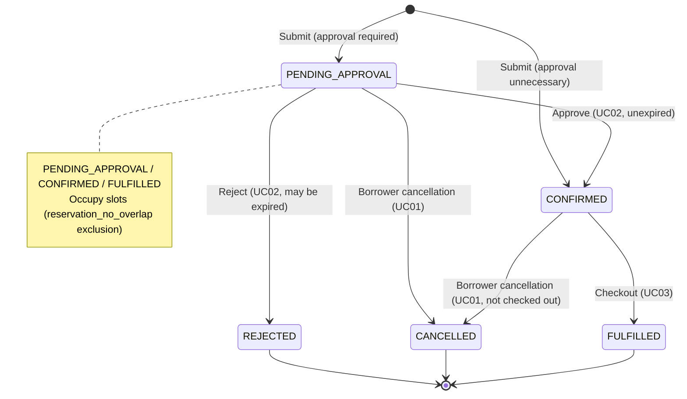

# UC01 Search and Reserve Equipment

Owner: Member 1. API details: [Equipment search/reservation contract](contracts/equipment-and-reservation.md); diagram sources in [`docs/diagrams/`](diagrams/).

## 1. Use Case

| Item | Content |
| --- | --- |
| Primary actor | Borrower (`BORROWER`) |
| Secondary actors | Approver (UC02 pending decisions), notifications (UC05) |
| Goal | Find suitable equipment and reserve a non-conflicting interval |
| Preconditions | Logged-in borrower, active account |
| Success | `CONFIRMED` without approval or `PENDING_APPROVAL` with approval, occupying the slot; `ReservationSubmitted` published |
| Requirements | Proposal 5.3 (search, availability, submit, cancel); rules 1/12 (no overlap), 2/8 (no maintenance booking), 4 (no cancellation after checkout), 10/11 (duration/quota) |

### 1.1 Main Flow

1. Open Find equipment; search name/asset tag, category, location, optionally a Singapore-time interval.
2. List non-retired items; with a window show Free / Not free and available-only filtering. Criteria persist in URL for refresh/share.
3. Select an item; reservation page shows next 14 days' busy slots without occupant identities.
4. Enter start/end and optional purpose; submit.
5. One transaction: lock equipment → requester → policies → slots/state → insert → event.
6. Show result in My reservations as Confirmed or Pending approval.

### 1.2 Alternative and Exception Flows

| ID | Trigger | Behavior | Test |
| --- | --- | --- | --- |
| A1 | No search results | Empty state, suggest fewer filters | `search.test.tsx` › shows an empty state and a retry |
| A2 | One endpoint, end before start, >90 days, available-only without interval | Inline frontend error, no request; backend 400 explanation | `search.test.tsx` › validates the time window; `EquipmentSearchCriteriaTest`; `ReservationApiTest#invalidSearchExplainsWhatToFix` |
| A3 | Overlap, including pending | 409, choose another slot and refresh | `ReservationPostgresTest.Submit#overlappingSlotIsRefusedButAdjacentSlotIsAccepted`, `#pendingReservationsAlsoHoldTheSlot`; `reservation.test.tsx` › explains a slot conflict |
| A4 | Concurrent booking | One success, others 409 via exclusion | `ReservationPostgresTest.Submit#parallelRequestsForTheSameSlotBookItExactlyOnce` (8 threads) |
| A5 | Maintenance/open fault | Page blocks booking, API 409 | `#equipmentUnderMaintenanceOrWithAnOpenFaultCannotBeReserved`; `reservation.test.tsx` › blocks equipment with an open fault |
| A6 | Retired/missing | Excluded search, API 404 | `#retiredOrUnknownEquipmentIsNotFound`, `Search#retiredOrUnknownEquipmentHasNoAvailabilityPage` |
| A7 | Still on loan at start | 409; starts after due time permitted | `#equipmentStillOnLoanAtTheRequestedStartIsUnavailable` |
| A8 | <30 minutes, >7 days, past start, >90-day horizon, already 3 open bookings | 422, **all violations together** | `ReservationPolicyTest`; `#bookingRulesAreReportedTogether`, `#quotaCountsOnlyOpenReservations`; `reservation.test.tsx` › lists every broken booking rule |
| A9 | Disabled account | 403 | `#disabledAccountsCannotReserve` |
| A10 | No BORROWER / act for another | Service `@PreAuthorize`, 403 | `ReservationServiceSecurityTest` |
| A11 | Approval required | `PENDING_APPROVAL`, UC02 | `#equipmentThatNeedsApprovalStartsPending`; all `ApprovalContract` tests |
| A12 | Borrower holds an overdue `ACTIVE` loan (rule 11, #22) | 422 `overdue-loan`, reported with the other violations; allowed again after the return | `ReservationPolicyTest#borrowerWithOverdueEquipmentIsRefused`, `#theOverdueRuleCanBeSwitchedOff`; `ReservationServiceTest#borrowerWithAnOverdueLoanIsRefusedWithoutWriting`; `ReservationPostgresTest#borrowerWithAnOverdueLoanCannotReserveUntilItIsReturned` |
| A13 | Longer than the item's own `max_borrow_duration` (V005, #44) | 422 `too-long` naming the item limit; the page states the limit and refuses before calling the server | `ReservationPolicyTest#anItemsOwnMaximumReplacesTheGlobalMaximum`; `ReservationPostgresTest#anItemsMaximumBorrowingDurationIsEnforced`; `reservation.test.tsx` › applies an item's own maximum and states it before submitting |
| C1 | Cancel pending/confirmed | `CANCELLED`, release slot, event | `Cancel#cancellingReleasesTheSlot`, `#pendingReservationCanBeCancelled`; `reservation.test.tsx` › cancels after confirmation |
| C2 | Cancel checked-out | 409, return rather than cancel; no Cancel button | `Cancel#checkedOutReservationCannotBeCancelled` |
| C3 | Cancel another user's | 404, no existence disclosure | `Cancel#anotherBorrowersReservationLooksMissing` |
| AU1 | Submit or cancel succeeds (Proposal 5.7, rule 9) | One `serms.audit_log` row (`RESERVATION_SUBMIT` / `RESERVATION_CANCEL`) in the same transaction, borrower as actor; a refused booking writes none | `ReservationPostgresTest#submitAndCancelAreAuditedWithTheBorrowerAsActor`, `#aRefusedBookingLeavesNoAuditRecord` |

## 2. Activity Diagram


## 3. Sequence Diagram (Reservation Submission)



## 4. Reservation States



## 5. Design

### 5.1 Layers (Technology Stack §2.2)

| Layer | equipment | reservation |
| --- | --- | --- |
| `api` | `EquipmentController`, `EquipmentProblemHandler` | `ReservationController`, `ReservationProblemHandler` |
| `service` | `EquipmentSearchService` | `ReservationService`, `ReservationApprovalService` (UC02), `ReservationApprovalAdapter`, events |
| `domain` | `EquipmentSearchCriteria`, `TimeWindow`, `EquipmentSummary` | `ReservationStatus`, `ReservationRequest`, `policy/*` |
| `repository` | `EquipmentSearchRepository` (JdbcTemplate) | `ReservationRepository` (JdbcTemplate) |

JdbcTemplate is used because queries depend on PostgreSQL ranges, exclusions, and `FOR UPDATE` (technology stack §1.2 allows JdbcTemplate for locking/complex queries).

### 5.2 Patterns (Proposal 9.3)

| Pattern | Location | Purpose |
| --- | --- | --- |
| Strategy | `ReservationPolicy` + 5 implementations (`StartInFuturePolicy`, `DurationPolicy`, `BookingHorizonPolicy`, `OpenReservationQuotaPolicy`, `OverdueLoanPolicy`), composed by `ReservationRules` | Independent rules; adding the overdue rule (#22) and the per-item limit (#44) needed no service-flow change |
| State | `ReservationStatus.isOpen / isCancellable` + triggers | Central transitions, database enforcement |
| Observer | `ReservationSubmitted`, `ReservationCancelled` → `notification.service.ReservationNotificationListener` (UC05) | Notifications without module coupling. Audit rows are written by `ReservationRepository.audit` in the booking transaction, like loans, approvals and maintenance (design note in [#22](devlog/issue-22-uc01-rules-audit.md)) |
| Adapter | `ReservationApprovalAdapter` | Connect UC02 port to public reservation service |

### 5.3 Consistency and Concurrency

- Check/write in one transaction; equipment → user/reservation lock order matches triggers and checkout/return.
- Application checks provide clear errors; **exclusion constraints guarantee no overlap**. Tests show one winner among 8 requests.
- Search Free and insert triggers use `serms.equipment_can_reserve`, avoiding inconsistent rules; another request winning first can still cause failure.

## 6. Test Bench and Execution

| Layer | Files | Count |
| --- | --- | --- |
| Backend unit | `reservation/domain/ReservationPolicyTest`, `equipment/domain/EquipmentSearchCriteriaTest`, `reservation/service/ReservationServiceTest` | 29 |
| Backend integration (PostgreSQL 18, Testcontainers, V001–V006) | `reservation/ReservationPostgresTest` | 34 |
| Backend authorization/API | `reservation/service/ReservationServiceSecurityTest`, `reservation/api/ReservationApiTest` | 17 |
| UC02 port adapter | `reservation/service/ReservationApprovalAdapterTest` | 6 |
| Frontend components (Vitest + MSW) | `features/equipment/search.test.tsx`, `features/reservation/reservation.test.tsx` | 22 |
| E2E (Playwright desktop/mobile) | `e2e/reservation.spec.ts` | 1 flow × 2 viewports |

```sh
cd app && ./mvnw verify          # Docker required; also generates target/openapi.json
cd frontend && pnpm install --frozen-lockfile
OPENAPI_FILE=../app/target/openapi.json pnpm check:api
pnpm lint && pnpm typecheck && pnpm test && pnpm build
pnpm test:e2e
```

Latest UC01 run (2026-10-15, main `0345a50`, Linux, Java 21, Node 22, PostgreSQL 18 Testcontainers): `./mvnw test -Dtest='Reservation*Test,Equipment*Test'` ran the 86 UC01 backend tests above (plus 7 tests of other modules matched by the pattern) with 0 failures, errors or skips; `vitest run src/features/equipment src/features/reservation` passed 22 of 22. The Playwright flow was not run locally (the machine's browser build did not match the pinned Playwright); it runs in the hosted `frontend` check. Earlier result (2026-10-05): 125 backend tests, UC01 service + domain line coverage 96.2%. Screenshots: [`docs/evidence/uc01/`](evidence/uc01/).

## 7. Known Limitations and Dependencies

The three 2026-10-05 limitations are resolved on `main`: Flyway migrations V001–V006 live in `app/src/main/resources/db/migration` and run against PostgreSQL 18; the identity schema is configurable (`serms.identity.schema`) and the `notification_principal` column exists in the `serms` model; the platform and UC02 branches are merged, so the UC01 code stands alone.

- Automatic cancellation of expired pending reservations (R1.11) is out of scope for this delivery ([D-009](collaboration/decisions.md#d-009-scope-freeze)). Expired requests show an "Expired" badge to approvers and can only be rejected ([UC02 contract](contracts/auth-and-approval.md)).
- Item limits (`max_borrow_duration`) are set in the demo data until the equipment management page (#17) edits them.
- The overdue rule is checked with a shifted clock in tests; in the running demo a loan only becomes overdue as real time passes ([#22](devlog/issue-22-uc01-rules-audit.md)).
- Member acceptance in a real browser across roles is tracked on the team's Issue #9 and #24; agent-run checks are not member acceptance.
