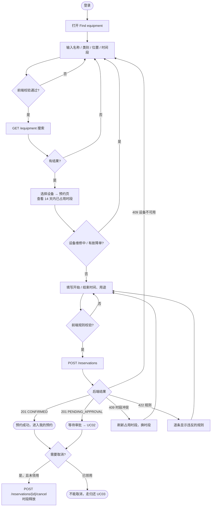
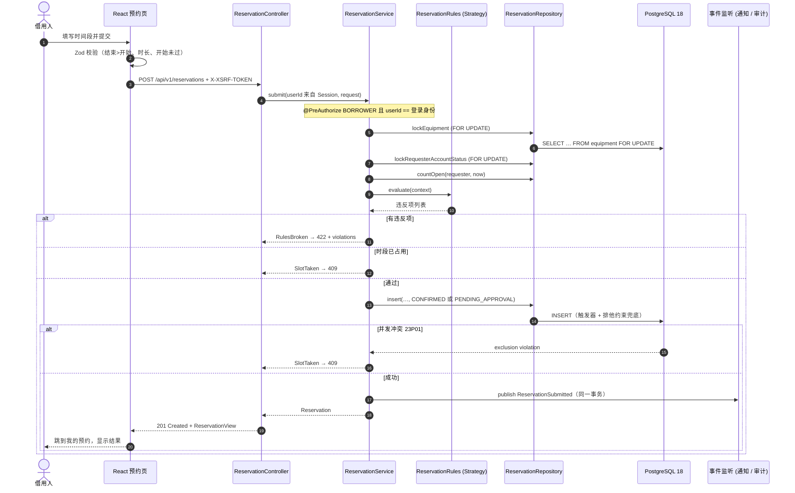
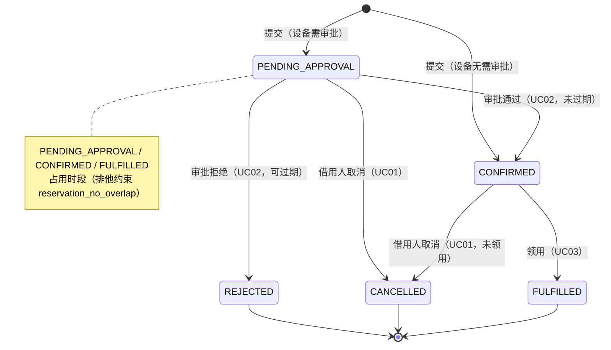

# UC01 搜索并预约设备

负责人：Member 1。接口细节见 [设备搜索与预约接口合同](contracts/equipment-and-reservation.md)；图的源文件在 [`docs/diagrams/`](diagrams/)。

## 1. 用例说明

| 项目 | 内容 |
| --- | --- |
| 主要参与者 | 借用人（`BORROWER`） |
| 次要参与者 | 审批人（UC02 审批待审批的预约）、通知模块（UC05） |
| 目标 | 找到合适的设备，并为一个不冲突的时间段预约它 |
| 前置条件 | 借用人已登录，账号为启用状态 |
| 成功后 | 生成一条 `CONFIRMED`（无需审批）或 `PENDING_APPROVAL`（需审批）的预约，并占用该时段；发布 `ReservationSubmitted` 事件 |
| 覆盖的需求 | Proposal 5.3（搜索、可用性、提交、取消）；业务规则 1、12（不允许重叠）、2、8（维修中的设备不可预约）、4（领用后不可取消）、10、11（时长与配额） |

### 1.1 主流程

1. 借用人打开 “Find equipment”，按名称 / 资产编号、类别、位置搜索，可选填一个时间段（新加坡时间）。
2. 系统列出未报废的设备；填了时间段时，每台设备显示 “Free / Not free”，可勾选 “只显示可用”。搜索条件写入 URL，刷新或分享链接后保留。
3. 借用人选择设备，进入预约页，看到该设备未来 14 天已被占用的时段（不显示占用人）。
4. 借用人填写开始、结束时间和用途（可选），提交。
5. 系统在一个事务里：锁设备 → 锁预约人 → 检查规则 → 检查时段和设备状态 → 写入预约 → 发布事件。
6. 系统返回预约结果，借用人进入 “My reservations”，看到 “已确认” 或 “等待审批”。

### 1.2 备选与异常流程

| 编号 | 触发条件 | 系统行为 | 对应测试 |
| --- | --- | --- | --- |
| A1 | 搜索没有结果 | 显示空状态，提示减少条件 | `search.test.tsx` › shows an empty state and a retry |
| A2 | 时间段只填了一端、结束早于开始、跨度超过 90 天、勾选 “只显示可用” 但没有时间段 | 前端就地提示，不发请求；后端同样返回 400 并说明原因 | `search.test.tsx` › validates the time window；`EquipmentSearchCriteriaTest`；`ReservationApiTest#invalidSearchExplainsWhatToFix` |
| A3 | 所选时段与已有预约重叠（含待审批的预约） | 409，提示换时段并刷新占用列表 | `ReservationPostgresTest.Submit#overlappingSlotIsRefusedButAdjacentSlotIsAccepted`、`#pendingReservationsAlsoHoldTheSlot`；`reservation.test.tsx` › explains a slot conflict |
| A4 | 两个人同时抢同一时段 | 只有一个成功，其余 409（数据库排他约束兜底） | `ReservationPostgresTest.Submit#parallelRequestsForTheSameSlotBookItExactlyOnce`（8 线程） |
| A5 | 设备维修中，或有未关闭的故障单 | 预约页显示不可预约；接口返回 409 | `#equipmentUnderMaintenanceOrWithAnOpenFaultCannotBeReserved`；`reservation.test.tsx` › blocks equipment with an open fault |
| A6 | 设备已报废或不存在 | 搜索不显示；接口返回 404 | `#retiredOrUnknownEquipmentIsNotFound`、`Search#retiredOrUnknownEquipmentHasNoAvailabilityPage` |
| A7 | 设备在所选开始时间仍借出未还 | 409；开始时间晚于应还时间则允许 | `#equipmentStillOnLoanAtTheRequestedStartIsUnavailable` |
| A8 | 时长不足 30 分钟或超过 7 天、开始时间已过、超过 90 天之后、已有 3 个未结束预约 | 422，**一次列出全部违反项** | `ReservationPolicyTest`；`#bookingRulesAreReportedTogether`、`#quotaCountsOnlyOpenReservations`；`reservation.test.tsx` › lists every broken booking rule |
| A9 | 账号已停用 | 403 | `#disabledAccountsCannotReserve` |
| A10 | 没有 BORROWER 角色，或试图替别人预约 / 取消 | 403（服务层 `@PreAuthorize`） | `ReservationServiceSecurityTest` |
| A11 | 设备需要审批 | 预约为 `PENDING_APPROVAL`，进入 UC02 | `#equipmentThatNeedsApprovalStartsPending`；`ApprovalContract` 全部测试 |
| C1 | 借用人取消待审批 / 已确认的预约 | 状态 `CANCELLED`，时段立即释放，发布 `ReservationCancelled` | `Cancel#cancellingReleasesTheSlot`、`#pendingReservationCanBeCancelled`；`reservation.test.tsx` › cancels after confirmation |
| C2 | 取消已领用的预约 | 409 “请归还而不是取消”；页面不显示取消按钮 | `Cancel#checkedOutReservationCannotBeCancelled` |
| C3 | 取消别人的预约 | 404（不暴露是否存在） | `Cancel#anotherBorrowersReservationLooksMissing` |

## 2. 活动图



## 3. 时序图（提交预约）



## 4. 预约状态



## 5. 设计

### 5.1 分层（tech-stack §2.2）

| 层 | equipment 模块 | reservation 模块 |
| --- | --- | --- |
| `api` | `EquipmentController`、`EquipmentProblemHandler` | `ReservationController`、`ReservationProblemHandler` |
| `service` | `EquipmentSearchService` | `ReservationService`、`ReservationApprovalService`（给 UC02）、事件 |
| `domain` | `EquipmentSearchCriteria`、`TimeWindow`、`EquipmentSummary` | `ReservationStatus`、`ReservationRequest`、`policy/*` |
| `repository` | `EquipmentSearchRepository`（JdbcTemplate） | `ReservationRepository`（JdbcTemplate） |

用 JdbcTemplate 而不是 JPA：这里的查询都依赖 PostgreSQL 的区间类型、排他约束和 `FOR UPDATE` 加锁（tech-stack §1.2 “需要加锁或复杂查询的地方用 JdbcTemplate”）。

### 5.2 设计模式（Proposal 9.3）

| 模式 | 位置 | 作用 |
| --- | --- | --- |
| Strategy | `ReservationPolicy` + 4 个实现，`ReservationRules` 组合 | 每条预约规则独立成类，增删规则不改 service |
| State | `ReservationStatus.isOpen / isCancellable` + 数据库触发器 | 状态转换集中定义，数据库兜底 |
| Observer | `ReservationSubmitted`、`ReservationCancelled` 事件 | 通知、审计订阅，不与预约模块耦合 |
| Adapter | `ReservationApprovalAdapter`（PR #8 合并后加入） | 把 UC02 的端口接到预约模块的公开 Service |

### 5.3 一致性与并发

- “检查后写入” 在一个事务内完成，并固定加锁顺序（设备 → 用户 / 预约），与触发器和领用 / 归还一致。
- 应用层检查是为了给出友好的错误；**真正保证不重叠的是排他约束**，并发测试证明 8 个并发请求只有 1 个成功。
- 搜索结果里的 “Free” 与插入触发器使用同一个数据库函数 `serms.equipment_can_reserve`，不会出现 “显示可用却提交失败” 的规则差异（只可能因为别人先抢到而失败）。

## 6. 测试台与运行方式

| 层 | 文件 | 数量 |
| --- | --- | --- |
| 后端单元 | `reservation/domain/ReservationPolicyTest`、`equipment/domain/EquipmentSearchCriteriaTest`、`reservation/service/ReservationServiceTest` | 23 |
| 后端集成（真实 PostgreSQL 18，Testcontainers，V001 + V002） | `reservation/ReservationPostgresTest` | 29 |
| 后端权限 / API | `reservation/service/ReservationServiceSecurityTest`、`reservation/api/ReservationApiTest` | 17 |
| 前端组件（Vitest + MSW） | `features/equipment/search.test.tsx`、`features/reservation/reservation.test.tsx` | 15 |
| 端到端（Playwright，桌面 + 手机） | `e2e/reservation.spec.ts` | 1 条 × 2 视口 |

```sh
cd app && ./mvnw verify          # 需要 Docker；同时生成 target/openapi.json
cd frontend && pnpm install --frozen-lockfile
OPENAPI_FILE=../app/target/openapi.json pnpm check:api
pnpm lint && pnpm typecheck && pnpm test && pnpm build
pnpm test:e2e
```

最近一次本地结果（2026-10-05）：后端 125 个测试全部通过，UC01 的 service + domain 行覆盖率 96.2%；前端 20 个组件测试、4 个 Playwright 用例（2 条流程 × 2 视口）全部通过。截图见 [`docs/evidence/uc01/`](evidence/uc01/)。

## 7. 已知限制与依赖

- 运行时数据源：`app/` 目前仍是通知模块的 H2 / MySQL 配置，UC01 的接口在 PostgreSQL 公共迁移移入 `app/` 之前**只能在测试中对真实数据库运行**。迁移整合由 Member 3 负责（tech-stack §7）。
- 登录：`UserAccountRepository` 目前查询 `public.app_user` 和 `notification_principal` 列，而 V002 的表在 `serms` schema、没有该列；整合时需要统一（见 [Sprint 状态](agile/sprint-status.md) 的风险表）。
- 本分支基于 `feature/wang-yuanmeng-platform-rest-react`（REST、登录、React 脚手架），该分支和 Draft PR #8 合并后，本分支的 PR 只剩 UC01 的改动。
