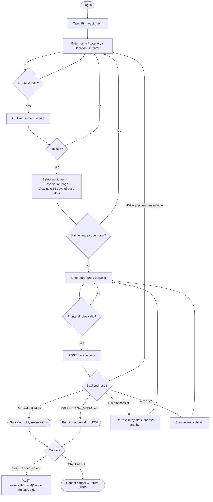
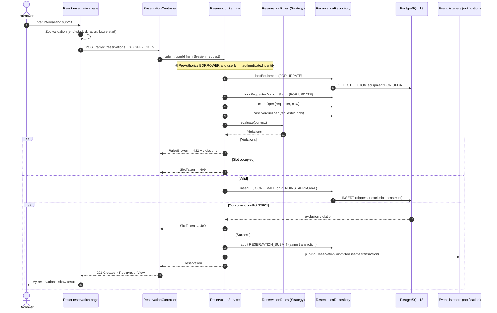
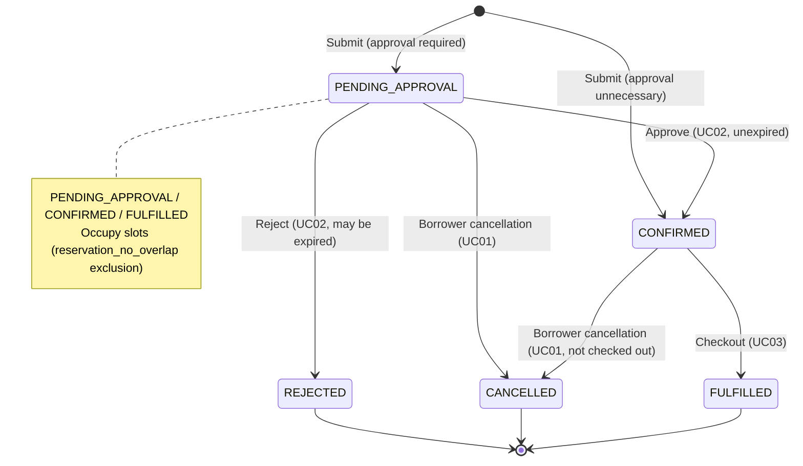
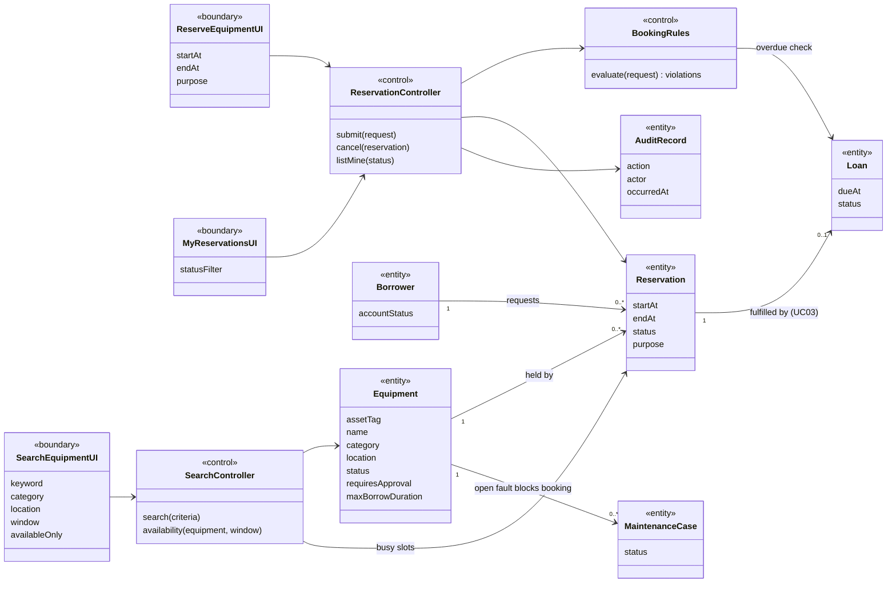
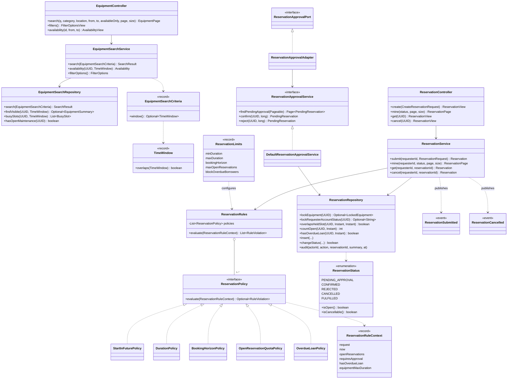

# UC01 Search and Reserve Equipment

Owner: Member 1 · Shi Wenqi (@YukiOvOb). While Shi Wenqi's account was unavailable, Liu Tongyao executed the UC01 completion work (Issue #22 through PRs #32 and #44; the V005 read fields of Issue #40 through PR #42) under [D-004](collaboration/decisions.md#d-004-local-first-integration-and-wenqi-task-execution); that work stays recorded as Liu Tongyao's. API details: [Equipment search/reservation contract](contracts/equipment-and-reservation.md); diagram sources in [`docs/diagrams/`](diagrams/).

## 1. Use Case

| Item | Content |
| --- | --- |
| Primary actor | Borrower (`BORROWER`) |
| Secondary actors | Approver (UC02 pending decisions), notifications (UC05) |
| Goal | Find suitable equipment and reserve a non-conflicting interval |
| Preconditions | Logged-in borrower, active account |
| Success | `CONFIRMED` without approval or `PENDING_APPROVAL` with approval, occupying the slot; `ReservationSubmitted` published |
| Requirements | Proposal 5.3 (search, availability, submit, cancel) and 5.7 (audit); rules 1/12 (no overlap), 2/8 (no maintenance booking), 4 (no cancellation after checkout), 9 (audit), 10 (duration, quota, item limit), 11 (overdue borrowers) |

### 1.1 Main Flow

1. Open Find equipment; search name/asset tag, category, location, optionally a Singapore-time interval.
2. List non-retired items; with a window show Free / Not free and available-only filtering. Criteria persist in URL for refresh/share.
3. Select an item; reservation page shows next 14 days' busy slots without occupant identities.
4. Enter start/end and optional purpose; submit.
5. One transaction: lock equipment → requester → policies → slots/state → insert → audit record → event.
6. Show result in My reservations as Confirmed or Pending approval.

### 1.2 Alternative and Exception Flows

| ID | Trigger | Behavior | Test |
| --- | --- | --- | --- |
| A1 | No search results | Empty state, suggest fewer filters | `search.test.tsx` › shows an empty state and a retry |
| A2 | One endpoint, end before start, >90 days, available-only without interval | Inline frontend error, no request; backend 400 explanation | `search.test.tsx` › validates the time window; `EquipmentSearchCriteriaTest`; `ReservationApiTest#invalidSearchExplainsWhatToFix` |
| A3 | Overlap, including pending | 409, choose another slot and refresh | `ReservationPostgresTest.Submit#overlappingSlotIsRefusedButAdjacentSlotIsAccepted`, `#pendingReservationsAlsoHoldTheSlot`; `reservation.test.tsx` › explains a slot conflict |
| A4 | Concurrent booking | One success, others 409 via exclusion | `ReservationPostgresTest.Submit#parallelRequestsForTheSameSlotBookItExactlyOnce` (8 threads) |
| A5 | Maintenance/open fault | Page blocks booking, API 409 | `#equipmentUnderMaintenanceOrWithAnOpenFaultCannotBeReserved`; `reservation.test.tsx` › blocks equipment with an open fault |
| A6 | Retired/missing | Excluded search, API 404 | `#retiredOrUnknownEquipmentIsNotFound`, `Search#retiredOrUnknownEquipmentHasNoAvailabilityPage` |
| A7 | Still on loan at start | 409; starts after due time permitted | `#equipmentStillOnLoanAtTheRequestedStartIsUnavailable` |
| A8 | <30 minutes, longer than the item's own limit (else 7 days), past start, >90-day horizon, already 3 open bookings | 422, **all violations together**; the page also stops an over-limit request before sending it | `ReservationPolicyTest`; `#bookingRulesAreReportedTogether`, `#anItemsMaximumBorrowingDurationIsEnforced`, `#quotaCountsOnlyOpenReservations`; `reservation.test.tsx` › lists every broken booking rule, applies an item's limit |
| A12 | Borrower holds an overdue, unreturned loan | 422 `overdue-loan` with the other violations; switchable by `serms.reservation.block-overdue-borrowers` | `ReservationPolicyTest#borrowerWithOverdueEquipmentIsRefused`, `#theOverdueRuleCanBeSwitchedOff`; `OverdueAndAudit#borrowerWithAnOverdueLoanCannotReserveUntilItIsReturned` |
| A9 | Disabled account | 403 | `#disabledAccountsCannotReserve` |
| A10 | No BORROWER / act for another | Service `@PreAuthorize`, 403 | `ReservationServiceSecurityTest` |
| A11 | Approval required | `PENDING_APPROVAL`, UC02 | `#equipmentThatNeedsApprovalStartsPending`; all `ApprovalContract` tests |
| C1 | Cancel pending/confirmed | `CANCELLED`, release slot, event | `Cancel#cancellingReleasesTheSlot`, `#pendingReservationCanBeCancelled`; `reservation.test.tsx` › cancels after confirmation |
| C2 | Cancel checked-out | 409, return rather than cancel; no Cancel button | `Cancel#checkedOutReservationCannotBeCancelled` |
| C3 | Cancel another user's | 404, no existence disclosure | `Cancel#anotherBorrowersReservationLooksMissing` |
| AU | Every successful submit and cancel | One `serms.audit_log` row in the same transaction; a refused request writes none | `OverdueAndAudit#submitAndCancelAreAuditedWithTheBorrowerAsActor`, `#aRefusedBookingLeavesNoAuditRecord`; `ReservationServiceTest#submitRecordsWhoBookedWhatAndWhen` |

The real-stack browser check `scripts/check-uc01-browser.mjs` repeats A3, A6, A8, A11, C1 and the shared search link against the local demo; see [the 2026-10-15 record](evidence/uc01/verification.md).

## 2. Activity Diagram



## 3. Sequence Diagram (Reservation Submission)



## 4. Reservation States



## 5. Design

### 5.1 Layers (Technology Stack §2.2)

| Layer | equipment | reservation |
| --- | --- | --- |
| `api` | `EquipmentController`, `EquipmentProblemHandler` | `ReservationController`, `ReservationProblemHandler` |
| `service` | `EquipmentSearchService` | `ReservationService`, `ReservationApprovalService` (UC02), `ReservationApprovalAdapter`, events |
| `domain` | `EquipmentSearchCriteria`, `TimeWindow`, `EquipmentSummary` | `ReservationStatus`, `ReservationRequest`, `policy/*` |
| `repository` | `EquipmentSearchRepository` (JdbcTemplate) | `ReservationRepository` (JdbcTemplate) |

JdbcTemplate is used because queries depend on PostgreSQL ranges, exclusions, and `FOR UPDATE` (technology stack §1.2 allows JdbcTemplate for locking/complex queries).

### 5.2 Patterns (Proposal 9.3)

| Pattern | Location | Purpose |
| --- | --- | --- |
| Strategy | `ReservationPolicy` + 5 implementations (`StartInFuturePolicy`, `DurationPolicy`, `BookingHorizonPolicy`, `OpenReservationQuotaPolicy`, `OverdueLoanPolicy`), composed by `ReservationRules` from `ReservationLimits` | Independent rules; adding, removing or switching off a policy needs no service change |
| State | `ReservationStatus.isOpen / isCancellable` + triggers | Central transitions, database enforcement |
| Observer | `ReservationSubmitted`, `ReservationCancelled` | Notification subscribers without module coupling; the audit row is written directly by `ReservationRepository.audit` so it cannot be skipped by a missing listener |
| Adapter | `ReservationApprovalAdapter` | Connect UC02 port to public reservation service |

### 5.3 Consistency and Concurrency

- Check/write in one transaction; equipment → user/reservation lock order matches triggers and checkout/return.
- Application checks provide clear errors; **exclusion constraints guarantee no overlap**. Tests show one winner among 8 requests.
- Search Free and insert triggers use `serms.equipment_can_reserve`, avoiding inconsistent rules; another request winning first can still cause failure.

### 5.4 Analysis and Design Class Diagrams

Analysis classes (boundary, control, entity), source [`uc01-analysis-class.mmd`](diagrams/uc01-analysis-class.mmd):



Design classes as implemented, source [`uc01-design-class.mmd`](diagrams/uc01-design-class.mmd). The analysis control `BookingRules` became the Strategy composition `ReservationRules`; the entity `AuditRecord` is a row written through `ReservationRepository.audit`; the UC02 port is reached only through `ReservationApprovalAdapter`.



## 6. Test Bench and Execution

| Layer | Files | Count |
| --- | --- | --- |
| Backend unit | `reservation/domain/ReservationPolicyTest` (12), `equipment/domain/EquipmentSearchCriteriaTest` (6), `reservation/service/ReservationServiceTest` (11), `reservation/service/ReservationApprovalAdapterTest` (6) | 35 |
| Backend integration (real PostgreSQL 18, all migrations V001-V006) | `reservation/ReservationPostgresTest` (34: Search, Submit, OverdueAndAudit, Cancel, MyReservations, ApprovalContract), `equipment/repository/EquipmentMasterDataPostgresTest` (5, V005 read fields) | 39 |
| Backend authorization/API | `reservation/service/ReservationServiceSecurityTest` (4), `reservation/api/ReservationApiTest` (13) | 17 |
| Frontend components (Vitest + MSW) | `features/equipment/search.test.tsx` (6), `features/reservation/reservation.test.tsx` (11) | 17 |
| E2E, mocked API (Playwright desktop/mobile) | `e2e/reservation.spec.ts` | 1 flow × 2 viewports |
| E2E, real local stack (React → Spring Boot → PostgreSQL 18) | `scripts/check-uc01-browser.mjs` | 8 checks × 2 viewports |

```sh
cd app && ./mvnw verify          # Docker, or SERMS_APP_TEST_JDBC_URL pointing at an isolated serms_test database
cd frontend && pnpm install --frozen-lockfile
OPENAPI_FILE=../app/target/openapi.json pnpm check:api
pnpm lint && pnpm typecheck && pnpm test && pnpm build
pnpm test:e2e
node scripts/check-uc01-browser.mjs   # from the repository root, with the local demo running
```

Latest local result (2026-10-15, main `f9596c1` plus this branch's script): all 589 backend tests passed on PostgreSQL 18.4; UC01 service + domain line coverage 96.4% (323 of 335 lines in `equipment.{domain,service}` and `reservation.{domain,domain.policy,service,service.event}`). Frontend lint, typecheck and all 133 component tests passed. The real-stack browser check passed 16 of 16. Details and screenshots: [UC01 verification record](evidence/uc01/verification.md); earlier mocked screenshots remain in [`docs/evidence/uc01/`](evidence/uc01/).

## 7. Known Limitations and Dependencies

- Automatic cancellation of expired pending reservations (R1.11) was dropped by [D-009](collaboration/decisions.md#d-009-scope-freeze); an expired request can only be rejected by an approver (UC02).
- Equipment keeps four states; there is no `RESERVED` equipment state ([D-008](collaboration/decisions.md#d-008-equipment-and-maintenance-state-models)). Whether an item is taken is derived from held reservation slots.
- Per-item limits come from equipment master data (V005). Editing them belongs to equipment management (#17, Zhou Fanhao); UC01 only reads them.
- Policy values (30 minutes to 7 days, 90-day horizon, 3 open reservations, overdue blocking on) are configuration defaults in `ReservationLimits`; changing them changes the contract in section 6 of the [UC01 contract](contracts/equipment-and-reservation.md#6-reservation-policies-configurable-strategy-pattern).
- Team member checks, cloud deployment and team Done are recorded separately from these local results.
